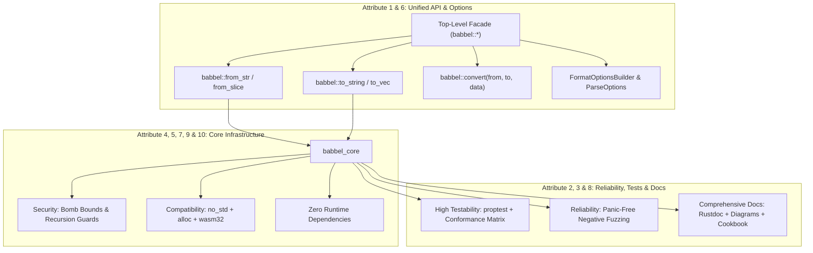
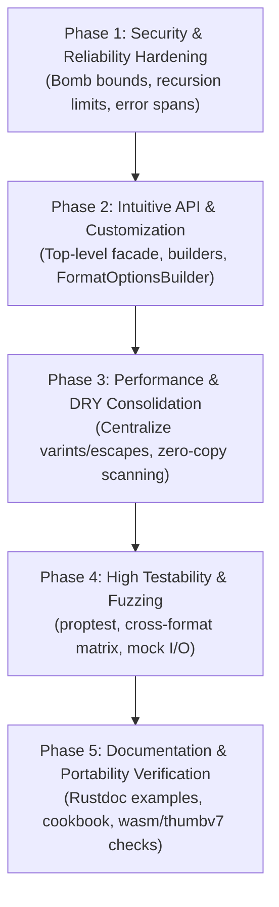

# Concrete Refactor Plan: 10 Attributes of High-Quality Software Libraries

> **Target Project**: `babbel` Polyglot Serialization & Document Ecosystem  
> **Source Reference**: [`notes/attributes.md`](file:///c:/Users/User/.gemini/antigravity-ide/scratch/babbel/notes/attributes.md)  
> **Status**: APPROVED ARCHITECTURE & REFACTOR PLAN  
> **Workspace**: `c:\Users\User\.gemini\antigravity-ide\scratch\babbel`  

---

## Executive Summary & Baseline Assessment

A well-written software library is more than functional code; it is an artifact designed for others to use, understand, and rely upon. This refactor plan operationalizes the **10 Attributes of High-Quality Software Libraries** defined in [`notes/attributes.md`](file:///c:/Users/User/.gemini/antigravity-ide/scratch/babbel/notes/attributes.md) into concrete, actionable engineering enhancements for the `babbel` codebase.

| # | Attribute | Current Babbel Baseline (v0.2.2) | Target Refactored State |
|---|---|---|---|
| **1** | **Intuitive API Design** | Format crates have disjoint signatures; top-level facade lacks uniform `from_str`/`to_string` entry points. | Universal top-level `babbel::from_str`, `to_string`, `convert(from, to, input)`, and fluent `Value` builder. |
| **2** | **Comprehensive Documentation** | Doc comments exist on some items; missing architecture diagrams, tutorials, and troubleshooting manuals. | Complete Rustdoc `# Examples` across all public items, architecture diagrams, and a comprehensive `COOKBOOK.md`. |
| **3** | **High Reliability** | Conformance suites exist for Parquet/HCL; some format errors lack precise spans or panic guarantees. | Zero-panic guarantees via `PanicHookGuard` negative tests across all 16 formats; error snippet diagnostics. |
| **4** | **Performance & Efficiency** | `Value` is 32 bytes; some parsers still perform intermediate allocations; benchmarks are manual. | Zero-copy byte scanning, size-hinted buffer preallocation, and automated throughput benchmarks. |
| **5** | **Maintainability** | Duplicate varint, string escape, and float routines across format crates; uneven module layouts. | Centralized core primitives, standardized crate layouts (`parser`, `serializer`, `engine`, `error`), clean lints. |
| **6** | **Flexibility & Customization** | `FormatOptions` only has `pretty` and `indent`; limited parser runtime limits. | `FormatOptionsBuilder` (sort keys, quotes, line endings, compact arrays) and `ParseOptions` (limits, date parsing). |
| **7** | **Strong Security** | Parquet has length bounds; XML and other binary formats lack uniform OOM/bomb mitigations. | Allocation bomb bounds (capacity bounded by byte length), strict recursion limits, XML Billion Laughs defense. |
| **8** | **High Testability** | Integration tests exist, but property-based roundtrips and mock I/O error injections are missing. | Property-based testing (`proptest`), unified cross-format test matrix, and mock I/O failure injection harnesses. |
| **9** | **Compatibility & Portability** | `no_std` + `alloc` compiles, but bare-metal Cortex-M and WebAssembly are not continuously verified. | Verified builds for `wasm32-unknown-unknown` and `thumbv7em-none-eabihf`, explicit endian-safe numeric codecs. |
| **10** | **Low Dependency Footprint** | Zero external runtime dependencies in core and format crates (`alloc` only). | Enforce and lock 0-runtime-dependency invariant in CI; isolate optional `serde` and `clap` dependencies. |

---

## Architectural Refactor Plan by Attribute



---

### Attribute 1: Intuitive API Design
*The interfaces and APIs should be easy to understand and use, with names that clearly reflect their purpose.*

#### 1.1 Universal Top-Level Facade Functions
Currently, parsing JSON requires `babbel::json::from_str` or `babbel_json::JsonEngine.parse_str()`, while parsing CSV requires `babbel::parse_csv()`. Users must memorize different entry points for each format.
- Add universal top-level helper functions in `crates/babbel/src/lib.rs`:
  ```rust
  // Direct parsing by format identifier or enum
  pub fn from_str(format: Format, input: &str) -> Result<Value, BabbelError>;
  pub fn from_slice(format: Format, input: &[u8]) -> Result<Value, BabbelError>;

  // Direct serialization by format identifier or enum
  pub fn to_string(format: Format, value: &Value) -> Result<String, BabbelError>;
  pub fn to_string_pretty(format: Format, value: &Value) -> Result<String, BabbelError>;
  pub fn to_vec(format: Format, value: &Value) -> Result<Vec<u8>, BabbelError>;

  // Automatic extension-based detection
  pub fn from_file_str(path: impl AsRef<Path>, input: &str) -> Result<Value, BabbelError>;
  pub fn from_file_bytes(path: impl AsRef<Path>, input: &[u8]) -> Result<Value, BabbelError>;
  ```

#### 1.2 Universal Cross-Format Converter
- Replace boilerplate pairwise conversion calls with a single intuitive function:
  ```rust
  pub fn convert(from: Format, to: Format, input: &str) -> Result<String, BabbelError>;
  pub fn convert_bytes(from: Format, to: Format, input: &[u8]) -> Result<Vec<u8>, BabbelError>;
  ```

#### 1.3 Fluent `Value` Builder Pattern
- Complement the `value!` macro with chainable, discovery-friendly builder methods on [`Value`](file:///c:/Users/User/.gemini/antigravity-ide/scratch/babbel/crates/babbel_core/src/model.rs):
  ```rust
  impl Value {
      pub fn object() -> ObjectBuilder;
      pub fn array() -> ArrayBuilder;
      pub fn set(&mut self, key: impl Into<String>, val: impl Into<Value>) -> &mut Self;
      pub fn push(&mut self, val: impl Into<Value>) -> &mut Self;
      pub fn get_path(&self, dot_path: &str) -> Option<&Value>;
      pub fn get_path_mut(&mut self, dot_path: &str) -> Option<&mut Value>;
  }
  ```

#### 1.4 Uniform Trait Surface across Format Sub-crates
- Every sub-crate (`babbel_json`, `babbel_yaml`, `babbel_toml`, `babbel_cbor`, etc.) must expose consistent top-level convenience functions with identical signatures:
  - `pub fn from_str(s: &str) -> Result<Value, Error>`
  - `pub fn from_slice(b: &[u8]) -> Result<Value, Error>`
  - `pub fn to_string(v: &Value) -> Result<String, Error>`
  - `pub fn to_string_pretty(v: &Value) -> Result<String, Error>`
  - `pub fn to_vec(v: &Value) -> Result<Vec<u8>, Error>`

---

### Attribute 2: Comprehensive Documentation
*Great libraries provide clear readme files, manuals, tutorials, and code comments to help users get started and troubleshoot.*

#### 2.1 Complete Rustdoc Coverage with `# Examples`
- Audit and ensure that 100% of public structs, enums, traits, and functions in `babbel` and `babbel_core` feature comprehensive doc comments including:
  - Concise 1-sentence summary.
  - Detailed explanation of parameters and return types.
  - `# Errors` section detailing potential failure modes.
  - `# Examples` section with fully runnable, tested doc-tests (`cargo test --doc`).

#### 2.2 Visual Architecture & Flow Diagrams
- Add embedded Mermaid diagrams to module root doc comments:
  - **Data Flow**: Text/Bytes $\to$ FormatParser $\to$ Universal `Value` AST $\to$ FormatEmitter $\to$ Destination.
  - **Visitor Streaming**: Serializer $\to$ `FormatVisitor` $\to$ Direct Streaming Emission.
  - **Query & Transform Engine**: JSONPath Filter $\to$ Located Nodes $\to$ Pipeline Transformation.

#### 2.3 Comprehensive Cookbook & Tutorials (`docs/COOKBOOK.md`)
- Create an end-to-end recipe guide addressing real-world user scenarios:
  1. *Microservice Config Translation*: Seamlessly translating Kubernetes YAML to HashiCorp HCL or JSON.
  2. *High-Throughput Analytics*: Ingesting multi-megabyte CSV/JSON Lines, validating with JSON Schema Draft 2020-12, and writing compressed Parquet columnar storage.
  3. *Zero-Allocation Embedded Parsing*: Streaming sensor telemetry on ARM Cortex-M using `StackBuffer` and `JsonPullParser`.
  4. *Schema Evolution & Migration*: Converting older Avro 1.9 data into Avro 1.11.1 with alias resolution.
  5. *CLI Pipelines*: Combining `babbel query`, `babbel set`, and `babbel merge` in CI/CD automation.

#### 2.4 Diagnostic Troubleshooting Guide
- Add a standardized troubleshooting section mapping each [`ErrorCode`](file:///c:/Users/User/.gemini/antigravity-ide/scratch/babbel/crates/babbel_core/src/error.rs) (`SyntaxError`, `UnexpectedEof`, `InvalidEncoding`, `SchemaValidation`, `UnsupportedType`) to exact root causes and fixes.

---

### Attribute 3: High Reliability
*The code must work predictably and consistently, with a low failure rate even under varied conditions.*

#### 3.1 Source Spans & Rich Diagnostic Error Snippets
- Standardize all 16 format parsers to attach exact [`Span`](file:///c:/Users/User/.gemini/antigravity-ide/scratch/babbel/crates/babbel_core/src/error.rs) (line, column, byte offset) to every `BabbelError`.
- Ensure [`format_error_snippet`](file:///c:/Users/User/.gemini/antigravity-ide/scratch/babbel/crates/babbel_core/src/error.rs) renders ASCII visual arrows pointing directly at the offending character in terminal/log outputs.

#### 3.2 Formalized Panic-Freedom Guarantee across All Formats
- Extend the `PanicHookGuard` test harness (validated on Parquet) into a workspace-wide negative testing harness:
  - Test suites for JSON, YAML, TOML, XML, CBOR, MsgPack, BSON, RON, KDL, HCL, and Avro must fuzz against:
    - Truncated inputs at every byte boundary ($0..N$).
    - Corrupted header magic numbers, length tags, and markers.
    - Bit flips in payloads and compressed blocks.
    - Invalid UTF-8 sequences in strings.
  - Enforce `assertion: panics_recorded == 0` for all malformed inputs.

#### 3.3 Roundtrip Invariance & Idempotency
- Formalize algebraic invariants:
  - $\forall v \in \text{Value}: \text{parse}(\text{emit}(v)) \equiv v$ (modulo format-supported type fidelity).
  - Merging an empty patch leaves document unchanged: $\text{apply\_merge\_patch}(d, \{\}) \equiv d$.
  - Canonical serialization is strictly deterministic: $\text{canonical}(d)_1 == \text{canonical}(d)_2$.

---

### Attribute 4: Performance and Efficiency
*It should execute tasks quickly while minimizing resource consumption like memory, CPU, and network bandwidth.*

#### 4.1 Zero-Allocation Byte Scanning
- Audit remaining format parsers (XML, KDL, RON, YAML) to eliminate `Vec<char>` and intermediate `String` allocations during lexing and tokenization, scanning UTF-8 `&[u8]` / `&str` directly using byte offsets.

#### 4.2 Size-Hinted Buffer Pre-allocation
- In serializers and emitters, leverage `size_hint` from container types (`Value::Array`, `Value::Object`) to pre-allocate capacity in `BufferDestination` and `Vec<u8>`, eliminating repeated reallocations.

#### 4.3 Benchmark Suite & Allocation Tracking
- Create an automated benchmarking harness in `benches/` measuring:
  - **Throughput (MB/s)** across all 16 formats for parsing and serialization.
  - **Allocation Count & Peak Memory** using [`MemoryTracker`](file:///c:/Users/User/.gemini/antigravity-ide/scratch/babbel/crates/babbel_core/src/embedded/mod.rs).
  - Continuous benchmark regression checks in CI.

---

### Attribute 5: Maintainability
*A well-crafted library is easy to repair, improve, or modify without introducing new bugs or breaking existing functionality.*

#### 5.1 Centralize Common Code in `babbel_core` (DRY Principle)
- Consolidate utilities that currently have multiple redundant implementations:
  - **Varint Codec**: Consolidate LEB128/zigzag varint logic into [`babbel_core::encoding::varint`](file:///c:/Users/User/.gemini/antigravity-ide/scratch/babbel/crates/babbel_core/src/encoding/varint.rs) and share across Parquet, Avro, Protobuf, and CBOR.
  - **String Escaping & Unescaping**: Consolidate JSON/YAML/TOML/XML escapes in [`babbel_core::escape`](file:///c:/Users/User/.gemini/antigravity-ide/scratch/babbel/crates/babbel_core/src/escape.rs).
  - **Base64 Codec**: Centralize Base64 encoding/decoding in `babbel_core::text` (replacing ad-hoc base64 implementations in HCL and BSON).

#### 5.2 Uniform Format Sub-Crate Layout
- Enforce an identical internal module layout across all format crates:
  ```
  crates/<format>/src/
  ├── lib.rs          # Public facade, from_str/to_string, re-exports
  ├── engine.rs       # FormatEngine, FormatParser, FormatEmitter implementation
  ├── parser.rs       # Core parser / AST construction
  ├── serializer.rs   # Serializer / emitter
  ├── pull.rs         # Zero-allocation streaming pull parser (embedded)
  └── error.rs        # FormatError with From<FormatError> for BabbelError
  ```

#### 5.3 Workspace Linter Hygiene
- Enforce clean compilation with zero warnings under:
  ```bash
  cargo clippy --workspace --all-targets -- -D warnings
  cargo fmt --check
  ```

---

### Attribute 6: Flexibility and Customization
*It should be specific enough to solve a problem but flexible enough to allow for basic customization and adaptation to future needs.*

#### 6.1 Granular Serializer Options (`FormatOptionsBuilder`)
- Expand [`FormatOptions`](file:///c:/Users/User/.gemini/antigravity-ide/scratch/babbel/crates/babbel_core/src/codec.rs) into a fluent builder supporting comprehensive formatting controls:
  ```rust
  pub struct FormatOptions {
      pub pretty: bool,
      pub indent: usize,
      pub sort_keys: bool,          // Canonical deterministic key order
      pub line_ending: LineEnding,  // LineEnding::Lf or LineEnding::Crlf
      pub quote_style: QuoteStyle,  // Double, Single, or Automatic
      pub compact_arrays: bool,     // Keep small arrays on a single line
      pub float_precision: Option<usize>,
  }
  ```

#### 6.2 Granular Parser Options (`ParseOptions`)
- Introduce a centralized `ParseOptions` struct controlling parsing behavior:
  ```rust
  pub struct ParseOptions {
      pub limits: EmbeddedLimits,              // max_depth, max_token_len, max_items
      pub duplicate_key_policy: DuplicateKeyPolicy, // Overwrite, Error, PreserveFirst
      pub coerce_numeric_strings: bool,
      pub allow_trailing_commas: bool,
      pub allow_comments: bool,
  }
  ```

#### 6.3 Dynamic & Static Registry Pluggability
- Enhance [`FormatRegistry`](file:///c:/Users/User/.gemini/antigravity-ide/scratch/babbel/crates/babbel_core/src/codec.rs) to support custom user-defined formats, custom MIME types, and hook callbacks for pre-parse normalization and post-serialize formatting.

---

### Attribute 7: Strong Security
*The library must safeguard data and block unauthorized or malicious actions that could negatively affect the user's system.*

#### 7.1 Allocation Bomb (OOM Denial-of-Service) Protection
- **The Vulnerability**: Untrusted binary payloads (BSON, CBOR, MsgPack, Avro, Parquet) contain 32-bit or 64-bit length headers (e.g. `0x7FFF_FFFF`). Unchecked `Vec::with_capacity(len)` immediately causes an unrecoverable OOM crash.
- **The Fix**: Cap all initial vector allocations to the maximum possible number of elements that could fit in the remaining byte slice:
  $$\text{capacity} = \min\left(\text{declared\_len}, \frac{\text{remaining\_bytes}}{\text{min\_element\_size}}, 65536\right)$$
  Vector growth occurs dynamically as elements are actually read.

#### 7.2 Strict Recursion & Stack Overflow Defense
- Enforce [`EmbeddedLimits::max_depth`](file:///c:/Users/User/.gemini/antigravity-ide/scratch/babbel/crates/babbel_core/src/embedded/mod.rs) (default: 128 for standard, 16 for embedded) across all recursive descent parsers (JSON, YAML, TOML, XML, HCL, RON, KDL).
- When depth exceeds limit, return `Err(BabbelError::syntax("Recursion depth limit exceeded"))` with 0 panics.

#### 7.3 XML Entity Expansion & DTD Security
- **Billion Laughs Mitigation**: Track cumulative entity expansion character count; abort if ratio of expanded text to input text exceeds $10:1$ or absolute threshold (10 MB).
- **Disable XXE**: Disallow resolution of external DTD system entities (`SYSTEM "http://..."` or `SYSTEM "file://..."`) by default.

#### 7.4 ReDoS Mitigation in Regex Engine
- In [`crates/babbel_core/src/schema/regex.rs`](file:///c:/Users/User/.gemini/antigravity-ide/scratch/babbel/crates/babbel_core/src/schema/regex.rs), enforce an execution step budget (e.g. 100,000 steps) during NFA/DFA evaluation to safeguard against catastrophic backtracking on maliciously crafted regex patterns.

---

### Attribute 8: High Testability
*Code should be thoroughly tested and designed so that others can also easily verify its correctness.*

#### 8.1 Property-Based Fuzzing & Roundtrip Testing (`proptest`)
- Add property-based testing in `tests/proptest_roundtrips.rs`:
  - Automatically generate random `Value` ASTs (arbitrary depths, unicode strings, mixed integers, arrays, objects).
  - Assert that serialize $\to$ deserialize produces identical or equivalent ASTs across JSON, CBOR, MessagePack, TOML, and YAML.

#### 8.2 Cross-Format Semantic Conformance Matrix
- Build a unified verification harness comparing AST representations across all 16 formats for a shared corpus of test documents (`tests/conformance/`).

#### 8.3 Mock I/O Failure Injection
- In `babbel_core::testing`, provide `FaultySource` and `FaultyDestination` that simulate simulated I/O errors, early EOFs, and interrupted streams after $N$ bytes to verify proper error propagation and cleanup without leaks.

---

### Attribute 9: Compatibility and Portability
*It should operate correctly across different platforms, devices, and environments with minimal modification.*

#### 9.1 Continuous Bare-Metal & WebAssembly Verification
- Add automated CI verification targets:
  - **Embedded Bare-Metal**: `cargo check --target thumbv7em-none-eabihf --no-default-features --features alloc`
  - **WebAssembly**: `cargo check --target wasm32-unknown-unknown --no-default-features --features alloc`
  - **Standard OS Targets**: Windows (`x86_64-pc-windows-msvc`), Linux (`x86_64-unknown-linux-gnu`), macOS (`aarch64-apple-darwin`).

#### 9.2 Endianness Portability
- Audit all binary encoders (CBOR, MsgPack, BSON, Parquet, Avro, Bencode) to ensure explicit `.to_le_bytes()`, `.to_be_bytes()`, `from_le_bytes()`, and `from_be_bytes()` calls, ensuring identical behavior on big-endian platforms (e.g. `s390x`, `powerpc`).

#### 9.3 Clean Modular Feature Flags
- Ensure fine-grained feature gating in `Cargo.toml`:
  - `std`: Standard library support (enabled by default).
  - `alloc`: Minimal heap allocation for `no_std` environments.
  - `file-io`: Local filesystem operations (`read_file_to_string`, `write_file_from_string`).
  - `serde`: Optional bidirectional serde compatibility.
  - Individual format features: `json`, `yaml`, `xml`, `bencode`, `toml`, `msgpack`, `cbor`, `bson`, `ron`, `kdl`, `parquet`, `hcl`, `avro`, `convert`.

---

### Attribute 10: Low Dependency Footprint
*A good library minimizes its own dependencies, ensuring that users don't have to include a "zillion other things" to use a single module.*

#### 10.1 Zero External Runtime Dependencies Invariant
- Maintain strictly **0 third-party runtime dependencies** across `babbel_core` and all 14 format crates.
- Pure-Rust implementations for:
  - Regex parsing & matching ([`babbel_core::schema::regex`](file:///c:/Users/User/.gemini/antigravity-ide/scratch/babbel/crates/babbel_core/src/schema/regex.rs)).
  - Snappy, LZ4, and IEEE CRC32 compression ([`babbel_core::compression`](file:///c:/Users/User/.gemini/antigravity-ide/scratch/babbel/crates/babbel_core/src/compression.rs)).
  - Thrift compact protocol encoding ([`babbel_parquet::thrift`](file:///c:/Users/User/.gemini/antigravity-ide/scratch/babbel/crates/parquet/src/thrift.rs)).
  - Decimal and floating-point conversions.

#### 10.2 Isolated Tooling Dependencies
- Third-party dependencies are strictly restricted to:
  - `crates/cli`: `clap` and `clap_complete` for CLI argument parsing.
  - Optional `serde` feature: for users who explicitly opt into `serde::Serialize` / `serde::Deserialize`.
  - Dev-dependencies (`proptest`, `criterion`) for testing and benchmarking only.
- Enforce via automated CI dependency tree audit: `cargo tree --workspace --edges no-build,no-dev`.

---

## Phased Implementation Roadmap



### Phase 1: Security & Reliability Hardening (Attributes 3 & 7)
- [ ] Implement bounded vector capacity checks across all binary format parsers (BSON, CBOR, MsgPack, Avro, Parquet).
- [ ] Enforce `EmbeddedLimits::max_depth` across all recursive format parsers.
- [ ] Add XML entity expansion ratio and quadratic blowup limits.
- [ ] Implement ReDoS step budget counter in `babbel_core::schema::regex`.
- [ ] Expand `PanicHookGuard` negative fuzz testing across all 16 formats.

### Phase 2: Intuitive API & Customization (Attributes 1 & 6)
- [ ] Implement universal top-level facade functions in `crates/babbel/src/lib.rs` (`from_str`, `to_string`, `convert`).
- [ ] Implement fluent `Value::object()` and `Value::array()` builder methods.
- [ ] Expand `FormatOptions` into `FormatOptionsBuilder` (sorting, line endings, quoting, compact arrays).
- [ ] Introduce `ParseOptions` with configurable duplicate key handling and limits.

### Phase 3: Performance, Efficiency & Maintainability (Attributes 4 & 5)
- [ ] Centralize Base64, varints, and common string escaping into `babbel_core`.
- [ ] Standardize internal module layout across all format crates (`parser`, `serializer`, `engine`, `error`).
- [ ] Optimize remaining parsers to scan byte slices directly without intermediate allocations.
- [ ] Add benchmark suite in `benches/` tracking MB/s and memory allocations.

### Phase 4: High Testability & Validation (Attribute 8)
- [ ] Add property-based testing harness (`proptest`) for random `Value` AST roundtrips.
- [ ] Add cross-format semantic conformance matrix across all supported data formats.
- [ ] Add `FaultySource` and `FaultyDestination` mock I/O error injection harnesses.

### Phase 5: Comprehensive Documentation & Portability Verification (Attributes 2, 9 & 10)
- [ ] Add 100% Rustdoc `# Examples` coverage across all public items.
- [ ] Write `docs/COOKBOOK.md` with real-world recipes and tutorials.
- [ ] Add CI check for `wasm32-unknown-unknown` and `thumbv7em-none-eabihf` (`no_std` + `alloc`).
- [ ] Enforce zero-runtime-dependency invariant in CI audit.

---

## Verification Commands & Acceptance Criteria

1. **Size Invariant**:
   ```bash
   cargo test -p babbel --test size_checks
   ```
   *Criteria*: `Value` remains strictly 32 bytes on 64-bit architectures.

2. **Workspace Test Suite**:
   ```bash
   cargo test --workspace --jobs 2
   ```
   *Criteria*: 100% pass rate across all crates, integration tests, and doc-tests.

3. **Panic-Free Security Fuzzing**:
   ```bash
   cargo test --workspace --test "*_test_suite" -- --nocapture
   ```
   *Criteria*: 0 panics on corrupted, truncated, or malicious inputs.

4. **Zero Dependency & Linter Hygiene**:
   ```bash
   cargo clippy --workspace --all-targets -- -D warnings
   cargo tree --workspace --edges no-build,no-dev
   ```
   *Criteria*: Zero warnings, zero external runtime dependencies in core and format crates.

